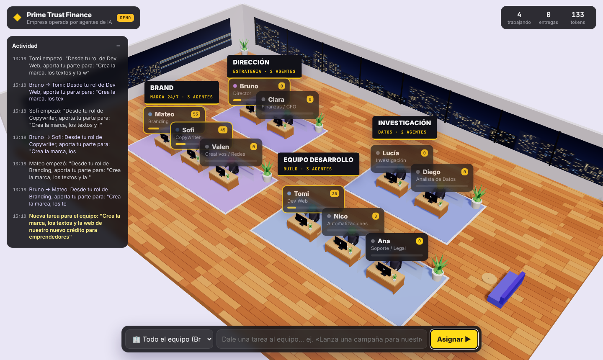

# 🏢 Oficina IA · Prime Trust Finance

Una oficina 3D interactiva donde cada escritorio es un **agente de IA** (con Claude). Le das una tarea al equipo, el director **Bruno** la divide y se la reparte a los agentes adecuados, y tú **los ves trabajar en tiempo real**: escriben en su teclado, se les llena la barra de progreso, cuentan tokens, se envían sobres entre escritorios y celebran cuando entregan.



## Qué puedes hacer

- **Dar una tarea a todo el equipo** (barra de abajo → "Todo el equipo"): Bruno planifica, delega en paralelo y al final entrega un resultado consolidado.
- **Hablar con un agente concreto**: haz clic en su personaje o en su tarjeta → se abre su chat. Puedes darle tareas o seguir la conversación (cada agente recuerda su historial).
- **Ver el trabajo en vivo**: la respuesta aparece mientras se escribe, con estado (pensando / trabajando / coordinando / entregó), progreso y tokens.
- **Copiar o descargar** cualquier entregable como `.md`.
- **Detener** a un agente o **reiniciar** su conversación.
- Feed de **actividad** con todo lo que pasa en la oficina.
- Mover la cámara: arrastra para girar, rueda para zoom, `Esc` para volver a la vista general.

## Departamentos (canal de YouTube)

La oficina es el centro de mando de un canal de YouTube que se crea desde cero, con la meta de 500.000 visitas en 90 días. Cada departamento tiene su propia oficina con paredes, y el jefe tiene su despacho con la meta en pantalla.

| Oficina | Agentes |
|---|---|
| Oficina del jefe | Bruno (Jefe del canal: reparte el trabajo y consolida) |
| Contenido rentable | Lucía (Tendencias y temas), Diego (Nichos y monetización) |
| Audiencia y horarios | Valen (Analista de audiencia), Ana (Horarios y calendario) |
| Producción | Sofi (Guionista), Tomi (Video y edición), Mateo (Miniaturas y títulos), Nico (Shorts y clips) |
| Gestión del canal | Clara (Creación y gestión), Pablo (SEO y crecimiento) |

Los botones rápidos sobre la barra de tareas lanzan los encargos más comunes: crear el canal desde cero, plan de 90 días, contenidos más rentables, público y hora exacta, y el primer video completo.

Los agentes no tienen acceso a internet ni a YouTube: entregan planes, guiones, títulos, horarios y pasos exactos, y dicen qué verificar con YouTube Studio, Google Trends o vidIQ. Crear la cuenta y subir los videos lo haces tú siguiendo sus pasos.

Para cambiar nombres, roles, personalidades, colores o equipos edita **`server/agents.js`**. La oficina se redibuja sola con los escritorios que hagan falta.

## Cómo arrancarla

Necesitas [Node.js](https://nodejs.org) 18 o superior.

```bash
npm install

# Con Claude de verdad
export ANTHROPIC_API_KEY="tu-clave"     # https://console.anthropic.com
npm start

# O en modo demo (respuestas simuladas, sin clave)
npm run demo
```

Abre **http://localhost:3000**.

Sin `ANTHROPIC_API_KEY` arranca solo en modo **DEMO** (la etiqueta arriba a la izquierda lo indica). Sirve para ver la oficina funcionando, pero las respuestas son simuladas.

### Variables opcionales

| Variable | Para qué | Por defecto |
|---|---|---|
| `ANTHROPIC_API_KEY` | Clave de la API de Claude | (modo demo) |
| `CLAUDE_MODEL` | Modelo que usan los agentes | `claude-opus-5-5` |
| `PORT` | Puerto del servidor | `3000` |
| `DEMO_MODE=1` | Forzar modo demo aunque haya clave | — |

## Cómo funciona

```
navegador (Three.js)  ⇄  server/index.js  ⇄  API de Claude
   escena 3D + chat        SSE en tiempo real     cada agente = system prompt
                           cola por agente        + su propio historial
                           orquestación
```

- `server/agents.js`: definición del equipo.
- `server/ai.js`: llamadas a Claude (streaming, pensamiento adaptativo y salida estructurada para el plan del director) y el simulador del modo demo.
- `server/index.js`: servidor HTTP sin frameworks, estado, colas por agente, flujo director → equipo → entregable, y eventos en vivo (Server-Sent Events). Guarda las conversaciones en `data/state.json`.
- `public/office.js`: la oficina 3D hecha con primitivas de Three.js (escritorios, monitores, vidrios, plantas, personajes animados, sobres voladores).
- `public/app.js`: interfaz (chat, feed, barra de tareas) y conexión con el servidor.

> Cada tarea consume tokens de tu cuenta de Anthropic. Una tarea de equipo hace una llamada para planificar, una por cada agente asignado y una para consolidar.

## Versión para el teléfono (Artifact de Claude)

La oficina también funciona como página publicada en claude.ai, sin servidor ni clave de API: los agentes usan la cuenta de Claude de quien la abre (la primera vez pide permiso).

- Enlace: https://claude.ai/artifact/T24kXRZUH4Zv8cdhcNHDn9 (privado; compártelo desde el menú *Share* de la página).
- Para regenerarla tras cambiar el código: `node scripts/build-artifact.mjs` crea `artifact/oficina-ia.html`, que se vuelve a publicar.
- `artifact/engine.js` hace en el navegador lo mismo que `server/index.js`. Las conversaciones se guardan solo en ese navegador.
